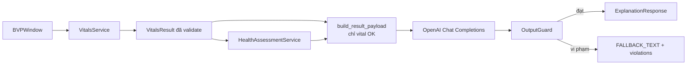

# Health Assessment và ranh giới OpenAI – Tuần 7 (Khoa)

Tuần 7 thêm 3 phần vào khối Vitals:

1. `HealthAssessmentService`: diễn giải wellness từ các chỉ số đã validate.
2. Tầng giải thích bằng OpenAI. Tầng này chỉ nhận JSON đã validate, và có guard chặn số liệu bịa và câu chẩn đoán.
3. REST API `/api/v1` để Quang gọi từ backend / frontend.

Ngoài ra Tuần 7 áp dụng 2 ngưỡng chất lượng mà Khang bàn giao trong `docs/ENGINE_BENCHMARK.md` mục 4.2.

## 1. Ngưỡng chất lượng từ Engine Benchmark (Khang)

| Ngưỡng | Hành vi trong `VitalValidator` | Cấu hình |
|---|---|---|
| `SQI < 0.40` | Lỗi `SIGNAL_QUALITY_UNUSABLE`, vital `INVALID`, không trả giá trị (trước đây là 0,3) | `ValidationConfig.signal_quality_invalid` |
| `r_mean < 0.35` | Cảnh báo `ROI_SIGNAL_DISAGREEMENT`, vital `BAD` (trán và má không tương quan) | `ValidationConfig.roi_agreement_warning` |

Đường đi của `r_mean`: `FrameResult.quality_metrics["r_mean"]` (pipeline của Khang) → `roi_agreement()` trong `integration/realtime_vitals.py` → `BVPWindow.roi_agreement` → `VitalCandidate.roi_agreement` → `RoiAgreementRule`. Nếu pipeline không có `r_mean`, hoặc giá trị là NaN, thì rule bỏ qua.

## 2. Health Assessment

`HealthAssessmentService` (`aivitals_engine/health/assessment.py`):

- chỉ dùng vital `OK`; chỉ số BAD / INVALID được đưa vào `excluded_metrics`;
- rule theo khoảng: nhịp tim lúc nghỉ 60–100 bpm, nhịp thở 12–20 brpm; HRV chỉ có finding ngữ cảnh (evidence `insufficient`);
- nội dung diễn giải nằm trong `health/knowledge/health_findings_vi.json`, trạng thái `pending_medical_review`. **Hào review wording** rồi đổi `review_status`;
- output luôn có `is_diagnosis = false` và `intended_use = wellness_screening_assist`.

Schema: `aivitals_engine/contracts/schemas/health_assessment.schema.json`, ví dụ: `example_health_assessment.json`.

## 3. Ranh giới OpenAI được thực thi bằng code

| Quy định trong plan | Cách code bảo đảm |
|---|---|
| OpenAI chỉ nhận structured result đã validate | `build_result_payload` ném `ResultNotValidatedError` nếu `status = INVALID` hoặc không có vital `OK`. Payload chỉ chứa vital `OK`; BAD / INVALID chỉ ghi tên vào `unavailable_metrics`, không kèm số |
| OpenAI không tính rPPG / BVP / HR / HRV / RR | Tầng explanation chỉ nhận `VitalsResult`, không nhận tín hiệu. Xu hướng được tính thống kê deterministic (`build_trend_payload`) rồi mới gửi sang |
| OpenAI không sửa số đo trong DB | `ExplanationService` không truy cập DB hay `VitalsService`, output chỉ là text kèm `source_result_ids` |
| Không chẩn đoán | System prompt cấm chẩn đoán; `OutputGuard` chặn cụm từ chẩn đoán không có phủ định ("bạn bị", "mắc bệnh", "rối loạn nhịp"...) |
| Không bịa số | `OutputGuard` so mọi số đi kèm đơn vị (bpm, ms, brpm, mmHg, nhịp/phút...) với danh sách số được phép |

Khi guard phát hiện vi phạm, text của LLM bị thay bằng `FALLBACK_TEXT`. Response ghi `guard_passed = false` và `violations` để audit.

| `kind` | Hàm | Input |
|---|---|---|
| `report` | `explain_result` | 1 `VitalsResult` + `HealthAssessment` (tùy chọn) |
| `question` | `answer_question` | 1 `VitalsResult` + câu hỏi ≤ 500 ký tự |
| `trend_summary` | `summarize_trend` | Nhiều `VitalsResult`, cần ≥ 2 giá trị OK cho cùng chỉ số |

Schema response: `explanation_response.schema.json`.

## 4. Cấu hình LLM

| Biến môi trường | Mặc định | Ghi chú |
|---|---|---|
| `OPENAI_API_KEY` | (bắt buộc) | Thiếu key thì chỉ endpoint giải thích trả 503 `SERVICE_UNAVAILABLE`, các endpoint khác vẫn chạy |
| `OPENAI_MODEL` | `gpt-5.4-nano` | Có thể đổi sang `gpt-5.4-mini` nếu cần câu văn tốt hơn |
| `OPENAI_BASE_URL` | `https://api.openai.com/v1` | Đổi sang nhà cung cấp tương thích OpenAI (Groq, OpenRouter, Ollama) |
| `OPENAI_REASONING_EFFORT` | `low` | Đặt rỗng để không gửi tham số này (cho nhà cung cấp không hỗ trợ) |
| `OPENAI_TEMPERATURE` | (không gửi) | Model GPT-5.x chỉ nhận temperature mặc định; chỉ đặt khi dùng model khác |

Client gọi REST trực tiếp bằng `httpx` (`explanation/llm_client.py`). Test dùng `httpx.MockTransport`, nên chạy test không cần key và không tốn phí.

Không commit key lên git. Key chỉ đặt trong biến môi trường hoặc file `.env` của máy chạy backend.

## 5. REST API `/api/v1`

Chạy: `uvicorn aivitals_engine.api.app:create_app --factory --port 8000`

| Method | Endpoint | Chức năng |
|---|---|---|
| GET | `/health` | Trạng thái engine, `explanation_enabled` |
| POST | `/vitals/compute` | Tính vitals từ cửa sổ BVP (nhận thêm `roi_agreement`) |
| DELETE | `/vitals/sessions/{session_id}` | Xóa trạng thái phiên đo |
| POST | `/validation/check` | Kiểm tra một giá trị đơn lẻ |
| POST | `/health-assessments` | Tạo đánh giá wellness từ `VitalsResult` |
| POST | `/explanations` | Giải thích / hỏi đáp / tóm tắt xu hướng |
| GET | `/contracts/*` | JSON schema của vitals, health assessment, huyết áp, state machine |
| GET | `/models`, `/models/{name}/{version}/verify` | Model registry và kiểm tra checksum |

Mọi response có dạng `{ "success", "data", "message" }`, còn lỗi có dạng `{ "success": false, "error", "message" }`.

## 6. Latency

`python -m aivitals_engine.benchmark latency --iterations 100 --window 30`

`VitalsService.compute` với cửa sổ 30 s @30 fps: mean 7,29 ms, p50 7,25 ms, p95 7,91 ms, max 10,4 ms (100 lần, CPU, máy dev). Thời gian gọi OpenAI không tính vào đây vì phụ thuộc mạng.

## 7. Việc cần Hào review

- `SYSTEM_PROMPT_VI` trong `explanation/prompts.py`.
- Danh sách cụm từ chẩn đoán trong `explanation/guard.py`.
- Nội dung `health/knowledge/health_findings_vi.json`.
